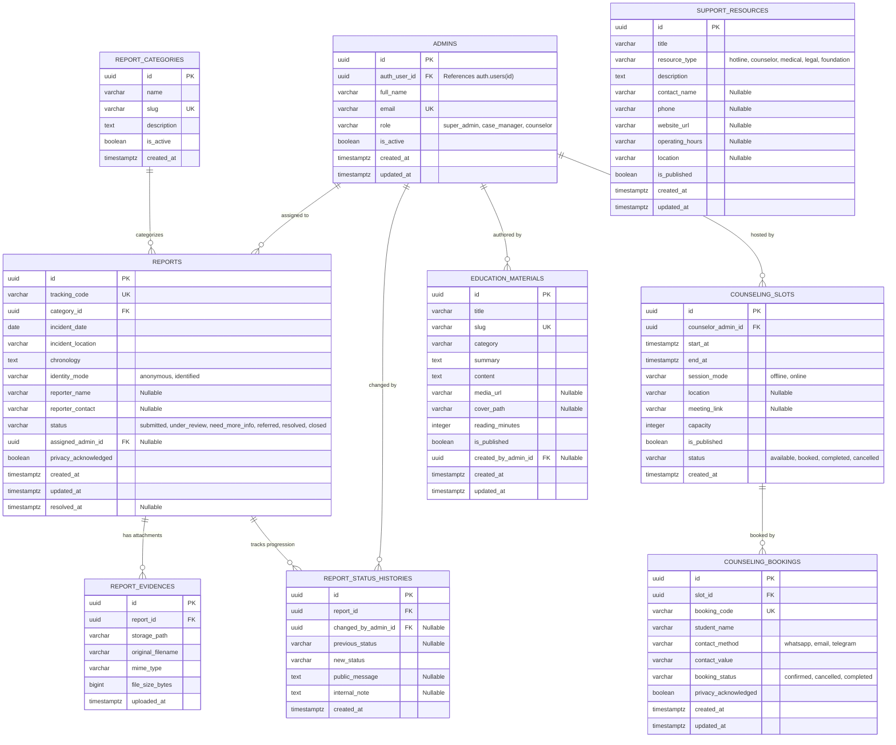

# ENTITY RELATIONSHIP DIAGRAM (ERD) & DATA DICTIONARY
## RUANGAMAN — PLATFORM PELAPORAN & PENDAMPINGAN KEKERASAN DAN PERUNDUNGAN

Dokumen ini mendefinisikan skema data relasional, tipe data, relasi antarentitas, indeks, dan batasan integritas untuk database RUANGAMAN yang disiapkan untuk PostgreSQL / Supabase pada Minggu 3.

---

## 1. DIAGRAM ENTITY RELATIONSHIP (ERD)

---

## 2. KAMUS DATA (DATA DICTIONARY)

### 2.1. Tabel `admins`
Menyimpan profil petugas berwenang (Satgas Anti-Kekerasan, Guru BK, Case Manager, Super Admin) yang terhubung dengan Supabase Auth.

| Kolom | Tipe | Nullable | Default | Deskripsi |
|---|---|---|---|---|
| `id` | `UUID` | No | `gen_random_uuid()` | Primary Key |
| `auth_user_id` | `UUID` | Yes | `NULL` | Foreign key ke `auth.users(id)` Supabase Auth |
| `full_name` | `VARCHAR(150)` | No | - | Nama lengkap petugas |
| `email` | `VARCHAR(255)` | No | - | Email resmi terdaftar (Unique) |
| `role` | `VARCHAR(30)` | No | `'case_manager'` | Role: `super_admin`, `case_manager`, `counselor` |
| `is_active` | `BOOLEAN` | No | `TRUE` | Status keaktifan akun petugas |
| `created_at` | `TIMESTAMPTZ` | No | `NOW()` | Waktu pembuatan |
| `updated_at` | `TIMESTAMPTZ` | No | `NOW()` | Waktu pembaruan |

### 2.2. Tabel `report_categories`
Daftar jenis pelanggaran atau perundungan yang dapat dipilih oleh pelapor.

| Kolom | Tipe | Nullable | Default | Deskripsi |
|---|---|---|---|---|
| `id` | `UUID` | No | `gen_random_uuid()` | Primary Key |
| `name` | `VARCHAR(100)` | No | - | Nama kategori (misal: Perundungan Fisik, Cyberbullying) |
| `slug` | `VARCHAR(100)` | No | - | Slug URL unik (misal: `perundungan-fisik`) |
| `description` | `TEXT` | No | - | Penjelasan batasan kategori |
| `is_active` | `BOOLEAN` | No | `TRUE` | Status aktif |
| `created_at` | `TIMESTAMPTZ` | No | `NOW()` | Waktu pembuatan |

### 2.3. Tabel `reports`
Pusat pencatatan insiden perundungan/kekerasan.

| Kolom | Tipe | Nullable | Default | Deskripsi |
|---|---|---|---|---|
| `id` | `UUID` | No | `gen_random_uuid()` | Primary Key internal |
| `tracking_code` | `VARCHAR(32)` | No | - | Kode lacak unik publik (misal: `RA-2026-X8K9M2`) |
| `category_id` | `UUID` | No | - | FK ke `report_categories(id)` |
| `incident_date` | `DATE` | No | - | Tanggal terjadinya peristiwa |
| `incident_location` | `VARCHAR(255)` | No | - | Tempat kejadian (kelas, kantin, medsos, toilet) |
| `chronology` | `TEXT` | No | - | Penjelasan runut kejadian dari pelapor |
| `identity_mode` | `VARCHAR(20)` | No | `'anonymous'` | Pilihan: `'anonymous'` atau `'identified'` |
| `reporter_name` | `VARCHAR(150)` | Yes | `NULL` | Nama pelapor (jika non-anonim) |
| `reporter_contact` | `VARCHAR(150)` | Yes | `NULL` | Kontak nomor HP / email (jika non-anonim) |
| `status` | `VARCHAR(30)` | No | `'submitted'` | Enum: `submitted`, `under_review`, `need_more_info`, `referred`, `resolved`, `closed` |
| `assigned_admin_id`| `UUID` | Yes | `NULL` | FK ke `admins(id)` petugas penanggung jawab |
| `privacy_acknowledged`| `BOOLEAN` | No | `FALSE` | Persetujuan kepatuhan ketentuan pelaporan |
| `created_at` | `TIMESTAMPTZ` | No | `NOW()` | Waktu pengiriman laporan |
| `updated_at` | `TIMESTAMPTZ` | No | `NOW()` | Waktu perubahan terakhir |
| `resolved_at` | `TIMESTAMPTZ` | Yes | `NULL` | Waktu kasus dinyatakan selesai |

### 2.4. Tabel `report_evidences`
Lampiran file pendukung laporan (foto, screenshot chat, dokumen).

| Kolom | Tipe | Nullable | Default | Deskripsi |
|---|---|---|---|---|
| `id` | `UUID` | No | `gen_random_uuid()` | Primary Key |
| `report_id` | `UUID` | No | - | FK ke `reports(id)` ON DELETE CASCADE |
| `storage_path` | `VARCHAR(255)` | No | - | Lokasi path di bucket Supabase Storage private |
| `original_filename`| `VARCHAR(255)` | No | - | Nama asli file saat diunggah |
| `mime_type` | `VARCHAR(100)` | No | - | Format MIME (misal: `image/jpeg`, `application/pdf`) |
| `file_size_bytes` | `BIGINT` | No | - | Ukuran file dalam bytes (Maksimal 5 MB) |
| `uploaded_at` | `TIMESTAMPTZ` | No | `NOW()` | Waktu file diunggah |

### 2.5. Tabel `report_status_histories`
Rekam jejak audit alur penanganan laporan (*audit trail*).

| Kolom | Tipe | Nullable | Default | Deskripsi |
|---|---|---|---|---|
| `id` | `UUID` | No | `gen_random_uuid()` | Primary Key |
| `report_id` | `UUID` | No | - | FK ke `reports(id)` ON DELETE CASCADE |
| `changed_by_admin_id`| `UUID` | Yes | `NULL` | FK ke `admins(id)` |
| `previous_status` | `VARCHAR(30)` | Yes | `NULL` | Status sebelum perubahan |
| `new_status` | `VARCHAR(30)` | No | - | Status baru |
| `public_message` | `TEXT` | Yes | `NULL` | Catatan transparan yang BISA dilihat oleh pelapor |
| `internal_note` | `TEXT` | Yes | `NULL` | Catatan rahasia/sensitif HANYA untuk internal tim |
| `created_at` | `TIMESTAMPTZ` | No | `NOW()` | Waktu mutasi status |

### 2.6. Tabel `education_materials`
Modul edukasi dan pencegahan perundungan berbasis LMS mini.

| Kolom | Tipe | Nullable | Default | Deskripsi |
|---|---|---|---|---|
| `id` | `UUID` | No | `gen_random_uuid()` | Primary Key |
| `title` | `VARCHAR(200)` | No | - | Judul materi edukasi |
| `slug` | `VARCHAR(200)` | No | - | Slug unik URL (misal: `mengenal-cyberbullying`) |
| `category` | `VARCHAR(50)` | No | - | Kategori: `pemahaman`, `pencegahan`, `tindakan`, dll |
| `summary` | `TEXT` | No | - | Ringkasan singkat untuk kartu preview |
| `content` | `TEXT` | No | - | Konten lengkap materi format Markdown/HTML |
| `media_url` | `VARCHAR(255)` | Yes | `NULL` | URL video/infografik pendukung |
| `cover_path` | `VARCHAR(255)` | Yes | `NULL` | Gambar sampul materi |
| `reading_minutes` | `INTEGER` | No | `5` | Estimasi waktu baca |
| `is_published` | `BOOLEAN` | No | `TRUE` | Status tayang publik |
| `created_by_admin_id`| `UUID` | Yes | `NULL` | FK ke `admins(id)` pembuat materi |
| `created_at` | `TIMESTAMPTZ` | No | `NOW()` | Waktu pembuatan |
| `updated_at` | `TIMESTAMPTZ` | No | `NOW()` | Waktu pembaruan |

### 2.7. Tabel `support_resources`
Layanan rujukan, hotline krisis, dan bantuan eksternal (Puskesmas, KPAI, SAPA 129).

| Kolom | Tipe | Nullable | Default | Deskripsi |
|---|---|---|---|---|
| `id` | `UUID` | No | `gen_random_uuid()` | Primary Key |
| `title` | `VARCHAR(150)` | No | - | Nama lembaga / layanan pendukung |
| `resource_type` | `VARCHAR(50)` | No | `'hotline'` | Jenis layanan: `hotline`, `counselor`, `medical`, dll |
| `description` | `TEXT` | No | - | Rincian bantuan yang disediakan |
| `contact_name` | `VARCHAR(150)` | Yes | `NULL` | Nama kontak / narahubung |
| `phone` | `VARCHAR(50)` | Yes | `NULL` | Nomor telepon darurat / WhatsApp |
| `website_url` | `VARCHAR(255)` | Yes | `NULL` | Tautan situs web resmi |
| `operating_hours`| `VARCHAR(100)`| Yes | `NULL` | Jam operasional layanan (misal: 24 Jam) |
| `location` | `VARCHAR(255)` | Yes | `NULL` | Alamat fisik jika berlaku |
| `is_published` | `BOOLEAN` | No | `TRUE` | Status tayang |
| `created_at` | `TIMESTAMPTZ` | No | `NOW()` | Waktu pembuatan |
| `updated_at` | `TIMESTAMPTZ` | No | `NOW()` | Waktu pembaruan |

### 2.8. Tabel `counseling_slots`
Slot waktu konseling tatap muka atau daring yang dibuka oleh Guru BK / Konselor.

| Kolom | Tipe | Nullable | Default | Deskripsi |
|---|---|---|---|---|
| `id` | `UUID` | No | `gen_random_uuid()` | Primary Key |
| `counselor_admin_id`| `UUID` | No | - | FK ke `admins(id)` |
| `start_at` | `TIMESTAMPTZ` | No | - | Waktu mulai sesi |
| `end_at` | `TIMESTAMPTZ` | No | - | Waktu berakhir sesi |
| `session_mode` | `VARCHAR(20)` | No | `'offline'` | Metode: `'offline'` atau `'online'` |
| `location` | `VARCHAR(255)` | Yes | `NULL` | Ruang konseling (misal: Ruang BK Lt. 2) |
| `meeting_link` | `VARCHAR(255)` | Yes | `NULL` | Link pertemuan jika online |
| `capacity` | `INTEGER` | No | `1` | Kuota peserta per slot |
| `is_published` | `BOOLEAN` | No | `TRUE` | Ditampilkan di formulir publik |
| `status` | `VARCHAR(20)` | No | `'available'`| Enum: `available`, `booked`, `completed`, `cancelled`|
| `created_at` | `TIMESTAMPTZ` | No | `NOW()` | Waktu pembuatan slot |

### 2.9. Tabel `counseling_bookings`
Pengajuan janji temu konseling oleh siswa.

| Kolom | Tipe | Nullable | Default | Deskripsi |
|---|---|---|---|---|
| `id` | `UUID` | No | `gen_random_uuid()` | Primary Key |
| `slot_id` | `UUID` | No | - | FK ke `counseling_slots(id)` ON DELETE CASCADE |
| `booking_code` | `VARCHAR(32)` | No | - | Kode unik bukti reservasi (misal: `BK-2026-9A1B2C`) |
| `student_name` | `VARCHAR(150)` | No | - | Nama siswa / nama panggilan aman |
| `contact_method`| `VARCHAR(30)` | No | `'whatsapp'`| Pilihan kontak: `whatsapp`, `email`, `telegram` |
| `contact_value` | `VARCHAR(150)` | No | - | Nomor HP / akun kontak |
| `booking_status`| `VARCHAR(20)` | No | `'confirmed'`| Status: `confirmed`, `cancelled`, `completed` |
| `privacy_acknowledged`| `BOOLEAN` | No | `FALSE` | Pernyataan kerahasiaan konseling |
| `created_at` | `TIMESTAMPTZ` | No | `NOW()` | Waktu pengajuan booking |
| `updated_at` | `TIMESTAMPTZ` | No | `NOW()` | Waktu pembaruan status booking |

---

## 3. STRATEGI INDEKS DATABASE
Untuk performa pencarian tinggi dan pelacakan cepat:
1. `reports.tracking_code` (Unique B-tree Index) — pencarian $O(1)$ untuk pelacakan publik.
2. `reports.status`, `reports.category_id`, `reports.created_at` (Compound Index) — penyaringan dan paginasi dashboard admin.
3. `education_materials.slug` (Unique Index) — query halaman detail edukasi.
4. `counseling_slots.start_at`, `counseling_slots.status` — pencarian ketersediaan jadwal.
5. `counseling_bookings.booking_code` (Unique Index) — verifikasi reservasi konseling.
