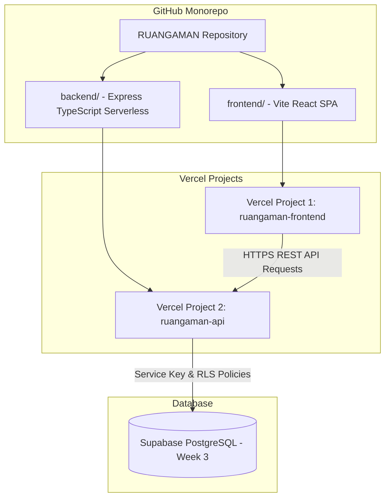

# PANDUAN DEPLOYMENT VERCEL DUAL-PROJECT
## RUANGAMAN FULL-STACK (FRONTEND & BACKEND)

Dokumen ini menjelaskan konfigurasi dan alur deployment platform RUANGAMAN sebagai dua proyek Vercel terpisah dari satu repository monorepo GitHub.

---

## 1. IKHTISAR ARSITEKTUR DEPLOYMENT



---

## 2. PROYEK 1: FRONTEND (Vercel)

### Konfigurasi Vercel:
- **Project Name:** `ruangaman-frontend` (atau kustom)
- **Framework Preset:** Vite
- **Root Directory:** `frontend`
- **Build Command:** `npm run build`
- **Output Directory:** `dist`
- **Install Command:** `npm install`

### Environment Variables:
| Variable | Value Production | Keterangan |
|---|---|---|
| `VITE_API_BASE_URL` | `https://ruangaman-api.vercel.app/api/v1` | URL endpoint production backend |

### Routing Single Page Application (SPA):
Frontend menyertakan file `frontend/vercel.json` untuk memastikan routing client-side React Router (`/`, `/lapor`, `/lacak`, dll) diarahkan ke `index.html`:
```json
{
  "rewrites": [
    { "source": "/(.*)", "destination": "/index.html" }
  ]
}
```

---

## 3. PROYEK 2: BACKEND API (Vercel Serverless Function)

### Konfigurasi Vercel:
- **Project Name:** `ruangaman-api`
- **Framework Preset:** Other
- **Root Directory:** `backend`
- **Build Command:** `npm run build`
- **Install Command:** `npm install`
- **Entry Point Vercel:** `src/index.ts` (meng-export `app` Express secara default)
- **Local Dev:** `src/server.ts` (menjalankan `app.listen(PORT, ...)` di port 4000)

### File `backend/vercel.json`:
```json
{
  "version": 2,
  "builds": [
    {
      "src": "src/index.ts",
      "use": "@vercel/node"
    }
  ],
  "routes": [
    {
      "src": "/(.*)",
      "dest": "src/index.ts"
    }
  ]
}
```

### Environment Variables Backend:
| Variable | Value Production | Keterangan |
|---|---|---|
| `NODE_ENV` | `production` | Mode produksi |
| `FRONTEND_URL` | `https://ruangaman.vercel.app` | Origin yang diizinkan CORS |
| `DEMO_ADMIN_EMAIL` | `admin@ruangaman.id` | Akun demo lokal |
| `DEMO_ADMIN_PASSWORD` | `PasswordDemo123!` | Password demo lokal |
| `SUPABASE_URL` | `https://xxxx.supabase.co` | (Dikonfigurasi Minggu 3) |
| `SUPABASE_ANON_KEY` | `eyJhb...` | (Dikonfigurasi Minggu 3) |
| `SUPABASE_SERVICE_ROLE_KEY` | `eyJhb...` | (Dikonfigurasi Minggu 3) |

---

## 4. LANGKAH-LANGKAH DEPLOYMENT

1. **Push ke GitHub:** Pastikan branch utama bersih dan semua test lolos.
2. **Import Proyek Frontend di Vercel Dashboard:**
   - Atur Root Directory ke `frontend`.
   - Set environment variable `VITE_API_BASE_URL`.
   - Klik Deploy.
3. **Import Proyek Backend di Vercel Dashboard:**
   - Atur Root Directory ke `backend`.
   - Set environment variable `FRONTEND_URL` ke domain frontend yang telah dibuat.
   - Klik Deploy.
4. **Verifikasi:**
   - Akses `https://ruangaman-api.vercel.app/api/v1/health` (harus merespons 200 OK).
   - Akses `https://ruangaman.vercel.app/` dan coba kirim laporan demo serta cek tracking.
