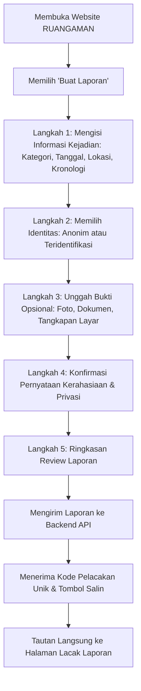
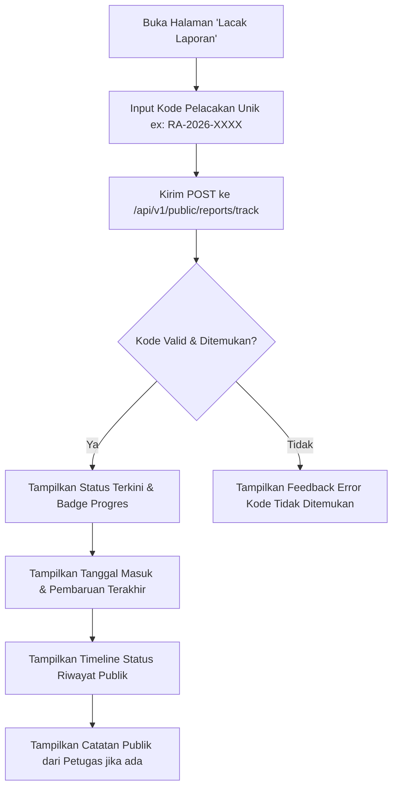

# DOKUMEN DASAR PENGEMBANGAN (WEEK 1 BASELINE)
## SISTEM INFORMASI PELAPORAN & PENDAMPINGAN KEKERASAN DAN PERUNDUNGAN "RUANGAMAN"

---

## 1. PENDAHULUAN & LATAR BELAKANG
RUANGAMAN dirancang sebagai platform terpadu ramah anak dan remaja yang menyediakan ruang aman digital (*safe space*) untuk pelaporan, pemantauan, edukasi pencegahan, dan penjadwalan pendampingan psikologis/konseling terkait kasus perundungan (*bullying*) dan kekerasan di lingkungan pendidikan (sekolah dan madrasah).

Hasil perancangan Minggu 1 mencakup:
- Pemetaan kebutuhan pengguna (Siswa/Korban, Saksi, Petugas BK/Konselor, Satgas Anti-Kekerasan Sekolah, dan Admin).
- Arsitektur Sitemap & Navigasi Halaman.
- User Flow Pelaporan & Pelacakan Kode Unik.
- Wireframing & Design System Empathic Visual Identity.
- Kerangka Regulasi (Permendikbudristek No. 46 Tahun 2023 tentang Pencegahan dan Penanganan Kekerasan di Satuan Pendidikan).

---

## 2. SITEMAP WAJIB MINGGU 1

### A. Pengguna Umum (Siswa, Saksi, Orang Tua)
| Halaman | Route | Deskripsi & Tujuan |
|---|---|---|
| **Beranda** | `/` | Portal utama, pengantar ramah, akses cepat ke 4 fitur utama, tombol darurat. |
| **Tentang RUANGAMAN** | `/tentang` | Landasan, visi, pilar layanan, transparansi data, dan komitmen kerahasiaan. |
| **Buat Laporan** | `/lapor` | Wizard formulir bertahap untuk insiden, mode anonim/teridentifikasi, upload bukti. |
| **Lacak Laporan** | `/lacak` | Pelacakan progres laporan hanya dengan kode unik (*zero authentication tracking*). |
| **Edukasi** | `/edukasi` | Portal LMS mini & materi artikel pencegahan perundungan dan hak perlindungan siswa. |
| **Pendampingan** | `/pendampingan` | Direktori kontak pertolongan cepat & formulir booking jadwal konseling Guru BK. |

### B. Pengguna Internal (Admin Satgas, Konselor BK, Case Manager)
| Halaman | Route | Deskripsi & Tujuan |
|---|---|---|
| **Login Admin** | `/admin/login` | Autentikasi aman petugas sekolah/konselor berwenang. |
| **Dashboard** | `/admin/dashboard` | Statistik beban kasus, agregasi status, distribusi kategori perundungan. |
| **Daftar Laporan** | `/admin/laporan` | Manajemen tabel kasus dengan filter status, kategori, mode identitas. |
| **Detail Laporan** | `/admin/laporan/:id` | Kronologi lengkap, verifikasi bukti, komunikasi publik & catatan internal tim. |
| **Riwayat Status** | `/admin/riwayat-status`| Audit log perubahan status kasus untuk kepatuhan SOP penanganan. |
| **Profil Admin** | `/admin/profil` | Informasi profil petugas, hak akses (*role*), dan status keaktifan. |

---

## 3. USER FLOW RESMI MINGGU 1

### Flow 1: Pelaporan Kasus (Pengguna Umum)

### Flow 2: Pelacakan Status Laporan (Pengguna Umum)

> **Aturan Privasi Pelacakan:** Tidak pernah menampilkan nama pelapor, kontak, kronologi penuh, atau catatan internal (*internal note*) pada halaman pelacakan publik.

---

## 4. DESIGN SYSTEM & IDENTITAS VISUAL

### Palet Warna Empatik
- **Soft Blue (`#E0F2FE` / sky-100)**: Memberikan atmosfer ketenangan dan penerimaan emosional.
- **Calm Teal (`#CCFBF1` / teal-100)**: Simbol kesembuhan, pemulihan mental, dan keselamatan.
- **Pure White (`#FFFFFF`)**: Kebersihan, ruang bernapas visual (*white space*), dan transparansi.
- **Deep Navy (`#17324D`)**: Warna primer teks dan elemen struktural; memberikan rasa ketegasan, wibawa hukum, dan kredibilitas institusi.
- **Teal Accent (`#0F9F91`)**: Warna aksi (CTA button, link penting, hover state, indikator aktif).

### Karakteristik Desain Visual
1. **Animated CSS Mesh Gradient:** Latar belakang dinamis namun lembut yang mengalir di latar belakang tanpa mengganggu keterbacaan (*contrast-safe*).
2. **Glassmorphism:** Kartu, header, dan sidebar dengan `backdrop-blur-md`, border transparan putih `rgba(255,255,255,0.6)`, dan drop shadow lembut.
3. **Micro-interaksi & Depth:**
   - 3D tilt lembut pada kartu utama beranda menggunakan VanillaTilt (6–8 derajat).
   - Partikel melayang halus menggunakan tsParticles (lingkaran lembut, warna teal/putih/biru, menghormati `prefers-reduced-motion`).
   - Animasi sambutan berbasis LottieFiles (`<dotlottie-wc>`) yang menggambarkan perlindungan dan kepedulian.

---

## 5. TAHAP TRANSISI MENUJU MINGGU 2
Seluruh pondasi Minggu 1 dipertahankan 100% dan diimplementasikan ke dalam arsitektur Full-Stack terpisah:
- Direktori `frontend/` (React + TypeScript + Vite + Tailwind CSS 4).
- Direktori `backend/` (Node.js + Express + TypeScript + Zod + Mock Repository).
- Direktori `database/` (ERD, DDL SQL Migration 9 Tabel, Seed Data, dan Dokumentasi).
- Direktori `docs/` (Kontrak API, Deployment Guide, dan Laporan Implementasi).
